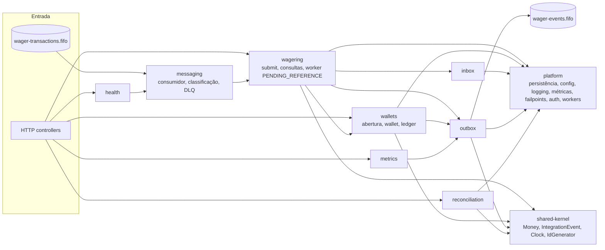
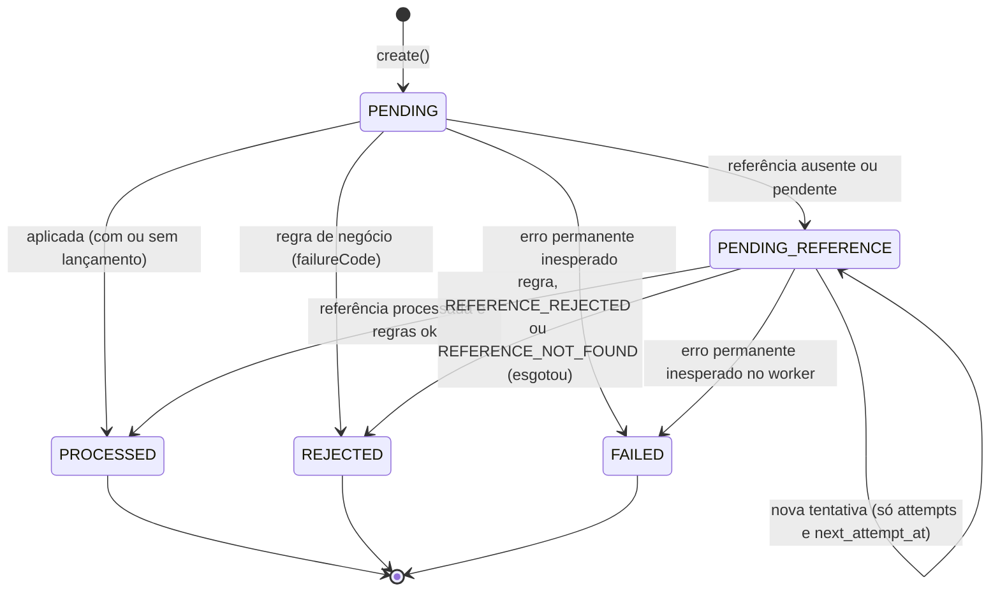

# Arquitetura

Este documento registra as decisões técnicas, os trade-offs e as limitações do serviço. Setup, comandos e exemplos de
uso estão no [README.md](README.md).

As interpretações do enunciado têm id estável (I-01 a I-76) e estão em
[docs/interpretacoes.md](docs/interpretacoes.md). As decisões de pesquisa (R-01 a R-45) e as notas de implementação
estão em `specs/00x-*/research.md` e `specs/00x-*/implementation-notes.md`.

## Sumário

1. [Contexto e invariantes](#1-contexto-e-invariantes)
2. [Mapa de módulos e dependências](#2-mapa-de-módulos-e-dependências)
3. [MikroORM](#3-mikroorm)
4. [Mapeamento do Money](#4-mapeamento-do-money)
5. [Estratégia transacional](#5-estratégia-transacional)
6. [Estratégia de concorrência](#6-estratégia-de-concorrência)
7. [Idempotência](#7-idempotência)
8. [Máquina de estados](#8-máquina-de-estados)
9. [Schema](#9-schema)
10. [Taxonomia de failureCode e mapeamento HTTP](#10-taxonomia-de-failurecode-e-mapeamento-http)
11. [Mensageria (consumidor)](#11-mensageria-consumidor)
12. [Outbox](#12-outbox)
13. [Política de retry, DLQ e PENDING_REFERENCE](#13-política-de-retry-dlq-e-pending_reference)
14. [Encerramento gracioso](#14-encerramento-gracioso)
15. [Reconciliação, health e métricas](#15-reconciliação-health-e-métricas)
16. [Observabilidade](#16-observabilidade)
17. [Autenticação](#17-autenticação)
18. [Testes](#18-testes)
19. [Decisões notáveis e bugs achados pelos testes](#19-decisões-notáveis-e-bugs-achados-pelos-testes)
20. [Limitações e trade-offs](#20-limitações-e-trade-offs)
21. [Decisões de interpretação mais relevantes](#21-decisões-de-interpretação-mais-relevantes)

## 1. Contexto e invariantes

O serviço recebe transações de apostas (BET, WIN, LOSS, REFUND, ROLLBACK) de vários provedores, por HTTP e pela fila
`wager-transactions.fifo`. Os dois canais usam o mesmo use case. Toda alteração de saldo vira um lançamento num ledger
imutável, e cada efeito publica eventos de integração por uma transactional outbox. A entrega é at-least-once dos dois
lados: a mesma operação pode chegar várias vezes, fora de ordem e em instâncias diferentes ao mesmo tempo.

Invariantes, e onde cada uma é garantida:

| Invariante | Garantia principal | Rede de segurança |
|---|---|---|
| Sem crédito ou débito duplicado | `UNIQUE(provider_id, idempotency_key)` e `UNIQUE(provider_id, external_transaction_id)`; PK da inbox; `UNIQUE(wallet_id, transaction_id)` no ledger | releitura sob o lock da wallet |
| Saldo nunca negativo | regra de domínio (`INSUFFICIENT_FUNDS`, `REVERSAL_WOULD_OVERDRAW`) sob lock | `CHECK (balance >= 0)` em `wallets` e `balance_after >= 0` no ledger |
| Saldo = ledger | wallet e lançamento gravados na mesma transação | trigger que exige `before[n] = after[n−1]`, `after = saldo da wallet` e, no `COMMIT`, saldo = cauda do ledger |
| Ledger imutável | não existe caminho de código que altere lançamentos | triggers recusam `UPDATE`, `DELETE` e `TRUNCATE` |
| Nenhum evento confirmado se perde | outbox na mesma transação do efeito | publicação at-least-once com lease; deduplicação por `eventId` |
| Nenhum evento antes do commit | quem publica é um worker separado, que só lê linhas confirmadas | — |
| Correto com N instâncias | todo estado de decisão está no PostgreSQL; nada em memória decide | testes com 3 processos reais |

**O banco é a fonte da verdade.** A deduplicação e a ordem por grupo do SQS FIFO são otimização, nunca garantia. Os
caches em memória não participam de nenhuma decisão financeira.

## 2. Mapa de módulos e dependências

Cada módulo segue camadas: `domain/` não depende de nada externo (nem de `@mikro-orm`, nem de `@nestjs`, nem de
relógio ou aleatoriedade); `application/` orquestra por portas; `infrastructure/` implementa as portas; `interfaces/`
expõe HTTP ou fila. O guardrail `test/unit/conventions.test.ts` verifica essas regras no código.



| Módulo | Responsabilidade |
|---|---|
| `shared-kernel` | `Money`, `IntegrationEvent<T>`, portas `Clock` e `IdGenerator` (UUIDv7) |
| `wallets` | `Wallet` (aggregate root), `WalletLedgerEntry`, abertura com OPENING, consultas de wallet e ledger |
| `wagering` | `WagerTransaction`, `WagerRulesService` (regras puras na ordem do I-44), `SubmitWagerTransactionUseCase`, `TransactionRecorder` (grava a decisão, compartilhado entre o submit e o worker), worker de PENDING_REFERENCE |
| `inbox` | `InboxMessage` e repositório (PK `consumer_name, message_id`) |
| `outbox` | `OutboxMessage`, publicador com lease, `OutboxLagReader` |
| `messaging` | porta `SqsPort`, adapter `@aws-sdk/client-sqs` (único lugar que importa o SDK), consumidor, classificação de erros |
| `reconciliation` | `reconcile()` puro e a leitura em snapshot somente leitura |
| `health`, `metrics` | `/health/live`, `/health/ready` e `/metrics` |
| `platform` | config validada no boot, MikroORM e unit of work, classificador de erros do pg, guarda do pool, HTTP (filtro de erros, correlationId), logger JSON, métricas em memória e Prometheus, failpoints, auth no-op, `WorkerRegistry`, encerramento |

**Papéis por instância** (env `*_ENABLED`): consumidor, publicador e worker são ligados por instância. No Compose, a
`app1` roda HTTP e consumidor; a `app2`, HTTP, consumidor e publicador; e a `app3`, HTTP, publicador e worker. Todos
os papéis podem rodar em várias instâncias ao mesmo tempo.

## 3. MikroORM

**Por que MikroORM**: é a opção preferencial do enunciado e tem o que a estratégia usa: `em.fork()` (identity map
isolado), `transactional()` com nível de isolamento, `LockMode.PESSIMISTIC_WRITE` (`SELECT … FOR UPDATE`), migrations
programáticas e erros de unicidade com o nome da constraint. Spike S-04 a S-09, research R-04 a R-06.

**`EntitySchema` + mappers, sem decorators nas entidades.** O Bun transpila TypeScript mas **não emite
`emitDecoratorMetadata`**, que o MikroORM e o Nest usariam para descobrir tipos. Duas consequências:

- no Nest, toda injeção é explícita, por `@Inject(TOKEN)` com tokens `Symbol`, e os DTOs são validados por pipe Zod
  explícito (R-02);
- no ORM, cada tabela tem um *record* de persistência mapeado por `EntitySchema` e um mapper explícito domínio ↔
  record. O domínio não importa nada do ORM, e a reidratação usa as factories `rehydrate` do domínio, que não
  revalidam transições (enunciado §6.0).

**`EntityManager` forkado por execução** (R-05, R-19): cada use case obtém `orm.em.fork()`; nada de `RequestContext`
global nem de EM compartilhado entre requisições, porque um identity map compartilhado é estado em memória que
serviria dado velho. Dentro de `transactional(cb)`, **toda** consulta usa o EM do callback. Uma segunda conexão não
veria as escritas da transação nem estaria sob o lock, e sob carga isso esgotaria o pool. O teste `pool-pressure`
(3 instâncias com `DB_POOL_MAX=5` e 100 BETs paralelas na mesma wallet, sem nenhum 503) prova isso.

**Escritas explícitas, não pelo flush do Unit of Work** (R-06): no caminho financeiro, as escritas usam `em.insert`
e `em.nativeUpdate` em ordem conhecida, conferindo as linhas afetadas. O flush reordena por grafo e agrupa comandos, o
que esconderia a ordem exigida pelos triggers (§5) e a constraint violada.

**SQL cru, onde e por quê**:

- **migrations**: SQL escrito à mão (triggers PL/pgSQL, índices parciais, FKs compostas); o gerador do ORM não
  produz nada disso;
- **claims com `FOR UPDATE SKIP LOCKED`** da outbox e do worker: precisam de `SKIP LOCKED` e de `UPDATE … WHERE id IN
  (…)` numa transação curta;
- **reconciliação**: agregado com `SUM` e `lag()` sobre o ledger, calculado no banco;
- **leituras de saúde e métricas**: `SELECT 1` e o gauge da outbox.

Placeholders são `?`, convenção do `em.execute`, e todo valor entra por parâmetro.

## 4. Mapeamento do Money

- `Money` é imutável, sobre `decimal.js` 10.6.0, numa instância isolada (`precision: 40`, `ROUND_HALF_EVEN`). Nenhuma
  operação arredonda: as entradas têm no máximo 2 casas e só existem soma e subtração (R-03).
- A entrada só aceita string no formato `^(0|[1-9]\d*)(\.\d{1,2})?$`, normalizada para 2 casas. Número JSON, sinal,
  notação científica, NaN, Infinity, string vazia e mais de 2 casas são recusados. O máximo é 9999999999999999.99, o
  limite de `NUMERIC(18,2)` (I-01 a I-03).
- **Persistência**: `NUMERIC(18,2)` com a moeda em coluna separada (`CHAR(3)`). O driver `pg` devolve `NUMERIC` como
  **string** (medido no spike S-05, inclusive no limite). As propriedades monetárias do `EntitySchema` usam
  `new DecimalType('string')` **explícito**: o modo padrão segue o `runtimeType` e poderia virar `number`. O mapper
  chama `Money.from(string)` (I-04).
- Agregados vindos de SQL cru (reconciliação) chegam como `numeric::text` e viram `Money` sem passar por `number`.
- Operações entre moedas diferentes lançam erro de domínio. O desafio usa BRL, e o conflito é testado com BRL × USD.
- O guardrail de convenções recusa `number`, `parseFloat` e `Number(` aplicados a dinheiro em `src/`.

## 5. Estratégia transacional

Toda submissão que pode mudar estado roda numa unit of work (`platform/persistence/unit-of-work.ts`): fork novo,
`transactional()` em **READ COMMITTED** e `SET LOCAL lock_timeout` como primeiro comando. Ordem das escritas no
caminho de efeito novo:

1. `SET LOCAL lock_timeout = WALLET_LOCK_TIMEOUT_MS`.
2. `SELECT … FROM wallets WHERE id = ? FOR UPDATE`: o lock pessimista da wallet é a primeira coisa que a transação faz.
3. Na fila, relê a inbox `(consumer_name, message_id)`: uma entrega concorrente pode ter gravado antes.
4. Relê a idempotência (consulta única do §7): se a transação já existe, é replay ou conflito, sem efeito.
5. Carrega a referência (REFUND, ROLLBACK, WIN e LOSS com referência) e verifica se ela já foi revertida.
6. `WagerRulesService.decide(...)`: função pura, na ordem do I-44.
7. `INSERT` da transação **já no status final** (PROCESSED, REJECTED ou PENDING_REFERENCE).
8. `UPDATE wallets SET balance, version WHERE id = ? AND version = ?`, só se o saldo muda; 0 linhas é quebra de
   invariante e vira 500.
9. `INSERT` do lançamento no ledger.
10. Antecipação das pendentes que referenciam esta transação, quando ela é terminal (I-73).
11. `INSERT` da inbox, só na fila.
12. `INSERT` dos eventos na outbox.
13. `COMMIT`; o trigger diferido confere saldo = cauda do ledger.

**Por que nesta ordem**:

- a transação vem antes do lançamento por causa da FK composta `(transaction_id, wallet_id, currency, amount)`;
- o trigger do ledger exige que a transação referenciada já esteja PROCESSED e que o `balance_after` seja igual ao
  saldo atual da wallet, então a wallet é atualizada antes do lançamento;
- a inbox entra depois da transação (FK `transaction_id`) e no mesmo commit, o que dá a atomicidade de "processou e
  registrou a mensagem";
- a outbox vem por último, com os eventos que descrevem exatamente o que foi gravado. Tudo é atômico: ou o commit leva
  transação, saldo, lançamento, inbox e eventos juntos, ou nada fica (enunciado §11).

**Repetição interna** (R-12): deadlock (`40P01`) e falha de serialização (`40001`) repetem a unit of work até 2 vezes,
cada tentativa **do zero**: fork novo, `WagerTransaction` nova, ids e eventIds novos (§19, bug 2). A violação do
índice de reversão única (`23505` em `wager_tx_single_reversal_uq`) repete uma vez; sob o lock, a 2ª tentativa vê a 1ª
reversão e responde `ALREADY_REVERSED`. Toda resposta 5xx sai depois do rollback, nunca com transação aberta.

**FAILED em transação separada**: quando o worker de PENDING_REFERENCE encontra um erro permanente inesperado, a
transação principal sofreu rollback; o FAILED é gravado numa unidade nova, sob o lock da wallet e com
`WHERE status = 'PENDING_REFERENCE'` (I-22, I-61).

## 6. Estratégia de concorrência

**Lock pessimista só na linha da wallet** (R-07): `SELECT … FOR UPDATE` em READ COMMITTED. A wallet é a unidade de
concorrência (enunciado §8) e a única linha travada explicitamente. Wallets diferentes não compartilham lock (não há
lock global), e a contenção na mesma wallet vira fila no banco, sem retry na aplicação. Em READ COMMITTED, cada comando
executado depois de obter o lock enxerga os commits anteriores; por isso a releitura de idempotência, inbox e
referência sob o lock sempre vê o estado mais recente.

**Defesa em profundidade**: o `UPDATE` da wallet tem `WHERE version = esperada` como asserção (não como estratégia), e
os `CHECK`s e triggers do banco são a última barreira.

**`lock_timeout` e hierarquia de timeouts** (I-51, R-11, R-27):

```text
WALLET_LOCK_TIMEOUT_MS (5 s)  <  DB_POOL_ACQUIRE_TIMEOUT_MS (8 s)
HTTP_SERVER_TIMEOUT_MS (20 s) >  pool (8 s) + lock (5 s) + 2 s
visibilidade do consumidor (30 s), leases do publicador e do worker (30 s)  >  pool + lock + 2 s
```

A espera pelo lock estoura antes da espera por conexão, e as duas antes do timeout HTTP. Assim o provedor sempre
recebe o 503 padronizado (`SERVICE_UNAVAILABLE`, `Retry-After`), sem efeito, e nunca um corte de conexão. Pelo mesmo
raciocínio, nenhuma mensagem fica visível de novo e nenhum lease vence enquanto a unidade de trabalho que os segura
ainda pode estar em andamento. A app recusa subir se a hierarquia for violada.

**Comparação com as alternativas**:

| Estratégia | Por que não foi a escolhida |
|---|---|
| Optimistic locking com retry (`version`) | com 50 requisições na mesma wallet, gera dezenas de conflitos e retries; o limite de retries pode estourar e virar erro para o provedor (cenário de 50 envios simultâneos). O `version` existe e é conferido, mas como asserção |
| `UPDATE … SET balance = balance − x WHERE balance >= x` (update atômico condicionado) | resolve só o saldo; a decisão também depende de idempotência, referência e reversão já existente, que precisam ser relidas no mesmo ponto serializado. Sem o lock, essas releituras correriam |
| `SERIALIZABLE` | falhas de serialização viram retries e não acrescentam garantia ao lock por linha |
| Lock em memória ou distribuído (Redis etc.) | proibido pelo enunciado como garantia; não sobrevive a várias instâncias sem infraestrutura extra |

**Ordem única de lock: wallet primeiro.** Nenhuma transação escreve em `wager_transactions` antes de travar a wallet,
o que impede ciclos de espera entre o submit, o worker e o FAILED. Há duas exceções deliberadas:

- os **claims** do worker e do publicador usam `FOR UPDATE SKIP LOCKED` e só avançam o lease; nunca esperam e nunca
  tocam saldo;
- a **antecipação** de dependentes roda dentro de uma transação que já travou a wallet de origem e só move
  `next_reference_attempt_at`.

## 7. Idempotência

**Escopo por provedor** (I-56): a chave é única dentro do provedor, com `UNIQUE(provider_id, idempotency_key)`, mais
`UNIQUE(provider_id, external_transaction_id)`. Dois provedores podem usar a mesma `Idempotency-Key` sem conflito.
Como o `payloadHash` inclui o `providerId`, uma unicidade global puniria um provedor pelas chaves de outro.

**Consulta única** (R-08): o caminho rápido (fora de transação) e a releitura sob lock usam a mesma consulta,
`WHERE provider_id = ? AND (idempotency_key = ? OR external_transaction_id = ?)`. Ela pega as duas linhas possíveis no
**mesmo snapshot**, e a da mesma chave tem precedência. Com hash igual, é replay; com hash diferente, ou com o mesmo
id externo sob outra chave, é 409 `IDEMPOTENCY_CONFLICT`. A consulta é uma só porque o uso de duas causou um bug (§19,
bug 1).

**Corrida até o `INSERT`** (I-27): requisições iguais na mesma wallet são serializadas pelo lock, e a releitura do
passo 4 resolve. Com a mesma chave em wallets diferentes, os locks são diferentes. O `INSERT` perdedor recebe `23505`,
identificado **pelo nome da constraint** (`wager_tx_provider_idempotency_uq` ou `wager_tx_provider_external_uq`). O
PostgreSQL só reporta a violação depois que a transação vencedora decide; então a perdedora faz rollback e repete a
consulta única **fora** da transação desfeita, num fork novo, e compara o hash. Não se usa `ON CONFLICT DO NOTHING`
porque ele engoliria também a violação do índice de reversão única (I-16).

**Replay**: devolve o `transactionId`, o status, o `failureCode` e o **saldo observado** gravado (`observed_balance`),
com `idempotentReplay: true` e o mesmo status HTTP do original, exceto 201, que vira 200 (I-26). O replay não grava
eventos e não altera o `correlation_id` da transação.

**Inbox** (fila, I-28): PK `(consumer_name, message_id)`. A mesma mensagem já processada é confirmada sem efeito. O
mesmo `messageId` com outro hash é mensagem venenosa e vai à DLQ (`INBOX_PAYLOAD_MISMATCH`). HTTP e fila compartilham
use case e tabelas, então o replay cruzado (enviar por HTTP o que já veio pela fila, e vice-versa) é reconhecido.

**Algoritmo do `payloadHash`** (I-25, R-09), passo a passo:

1. Partir do corpo **já validado** pelo schema Zod. Campos desconhecidos já foram descartados (I-57).
2. Montar o objeto só com os campos de negócio: `providerId`, `externalTransactionId`, `playerId`, `walletId`,
   `roundId`, `gameId`, `kind`, `money: { amount, currency }` e `referenceExternalTransactionId`. Este último é
   **omitido** se ausente.
3. Normalizar: `amount` com 2 casas ("25" e "25.00" geram o mesmo hash); `walletId` em minúsculas (UUID, I-58). Os
   demais ids entram exatamente como enviados, porque são case-sensitive.
4. Ficam fora o header `Idempotency-Key`, o `idempotencyKey` da mensagem, `messageId`, `occurredAt`, o correlationId e
   qualquer metadado de transporte.
5. Serializar em JSON canônico com serializador próprio: chaves ordenadas recursivamente, sem espaços, UTF-8, chaves
   `undefined` omitidas.
6. `SHA-256` do resultado, em hex minúsculo (64 caracteres).

O cálculo é o mesmo no HTTP e na fila e está em `test/unit/payload-hash.test.ts`.

## 8. Máquina de estados



- **PENDING** só existe em memória: a transação é inserida já no status final do passo 7 (§5).
- PROCESSED, REJECTED e FAILED são **terminais**. Tentar transicioná-los lança `InvalidTransactionStateError`, que é
  erro de programação, e o trigger `jg_wager_tx_guard` também recusa a transição no banco (I-11).
- OPENING nasce PENDING e vira PROCESSED na mesma transação da criação da wallet (I-07); não pode ser submetido de fora.
- FAILED só é gravado pelo worker de PENDING_REFERENCE (I-61). O consumidor da fila nunca grava FAILED: o erro
  permanente da fila vai para a DLQ, para que a mensagem possa ser reprocessada (redrive) depois de corrigido o bug.

Efeitos no saldo (I-12): BET debita; WIN e REFUND creditam; LOSS não move saldo nem gera lançamento; ROLLBACK inverte a
referência (BET → crédito; WIN ou REFUND → débito).

## 9. Schema

Seis migrations em SQL cru, todas com `down` (testadas em `up → down → up`):

| Migration | Conteúdo |
|---|---|
| `20261107000100` | `wallets` e `wager_transactions` |
| `20261107000200` | `wallet_ledger_entries` |
| `20261107000300` | `outbox_messages` |
| `20261107000400` | funções e triggers de guarda |
| `20261108000100` | `inbox_messages` |
| `20261108000200` | índices parciais do worker de PENDING_REFERENCE |

**Constraints principais**:

- `wallets`:
  - `CHECK (balance >= 0)`, `UNIQUE(player_id, currency)` (I-10) e `CHECK (version >= 1)`;
  - `UNIQUE(id, currency)`, alvo da FK de moeda.
- `wager_transactions`:
  - os dois UNIQUE de idempotência (§7);
  - `CHECK`s de kind, status, moeda, `amount > 0` (exceto LOSS), referência exigida por kind, `failure_code` só e
    sempre em REJECTED e FAILED, `processed_at` coerente, `observed_balance` presente e identidade reservada do OPENING;
  - `UNIQUE(id, wallet_id, currency, amount)`, alvo da FK composta do ledger.
- `wallet_ledger_entries`:
  - `amount > 0`, `balance_before >= 0`, `balance_after >= 0`;
  - **aritmética**: `balance_after = balance_before ± amount` conforme a direção;
  - `UNIQUE(wallet_id, transaction_id)` (um lançamento por transação e wallet) e `seq` identity para o cursor;
  - **FK composta** `(transaction_id, wallet_id, currency, amount) → wager_transactions`: o banco impede lançamento em
    outra wallet, em outra moeda ou com valor diferente do da transação.
- `inbox_messages`: PK `(consumer_name, message_id)`, formato do `message_id` e hash.
- `outbox_messages`: índice parcial `outbox_pending_idx` só nas linhas pendentes, usado pelo claim e pelo gauge.

**Índice parcial de reversão única** (I-16):

```sql
CREATE UNIQUE INDEX wager_tx_single_reversal_uq ON wager_transactions (reference_transaction_id)
  WHERE kind IN ('REFUND','ROLLBACK') AND status = 'PROCESSED';
```

O enunciado diz que "uma referência não pode ser revertida duas vezes **pelo mesmo tipo de operação**". Lido ao pé da
letra, uma BET poderia receber um REFUND **e** um ROLLBACK, e o jogador seria creditado duas vezes pela mesma aposta.
Adotamos a leitura **estrita**: REFUND e ROLLBACK compartilham a unicidade, e uma transação é revertida **uma única vez
no total**. A segunda tentativa, de qualquer tipo, é REJECTED `ALREADY_REVERSED`. A regra é verificada sob o lock e
garantida pelo índice, que só conta reversões PROCESSED; tentativas rejeitadas continuam auditáveis.

**Triggers de guarda** (`20261107000400` e `20261108000100`), que põem as invariantes no banco e não só no código:

| Trigger | O que impede |
|---|---|
| `ledger_no_update_delete_trg`, `ledger_no_truncate_trg` | alterar ou apagar lançamentos (`P0001`) |
| `ledger_before_insert_trg` | lançamento para transação não PROCESSED ou LOSS; direção errada para o kind (ROLLBACK precisa ser o inverso da referência); quebra da cadeia (`before ≠ after anterior`, ou `before ≠ 0` no primeiro); `balance_after` diferente do saldo atual da wallet |
| `wallets_match_ledger_tail_trg` (`DEFERRABLE INITIALLY DEFERRED`) | no `COMMIT`, saldo da wallet diferente do `balance_after` do último lançamento (`wallet_ledger_tail_mismatch`) |
| `wallets_guard_trg` | `DELETE` de wallet; mudar a identidade (id, player, moeda, criação); mudar o saldo sem incrementar `version` em 1; mudar `version` sem mudar o saldo |
| `wager_tx_guard_trg`, `wager_tx_no_truncate_trg` | qualquer `UPDATE` de transação em estado terminal; transição fora do I-11; mudar campos de identidade e de negócio (chaves, hash, wallet, valor, referência, correlationId); `DELETE`/`TRUNCATE` |
| `inbox_no_update_delete_trg`, `inbox_no_truncate_trg` | alterar ou apagar o histórico da inbox |

Consequência para os testes: nenhum dado é limpo. Cada arquivo de teste usa um banco próprio, clonado de um template
já migrado, e o guardrail proíbe `TRUNCATE`, `DELETE`, `DISABLE TRIGGER` e `session_replication_role` (§18).

## 10. Taxonomia de failureCode e mapeamento HTTP

O provedor decide entre reenviar, corrigir ou desistir sem interpretar texto. Toda rejeição tem um `failureCode`
estável e um `retryable`. Em REJECTED, o reenvio da mesma requisição devolve o mesmo resultado, porque o estado é
terminal.

| Código | Quando | retryable | Ação |
|---|---|---|---|
| `INSUFFICIENT_FUNDS` | BET sem saldo | false | desistir |
| `REVERSAL_WOULD_OVERDRAW` | reversão deixaria saldo negativo (código distinto do anterior) | false | desistir |
| `BALANCE_LIMIT_EXCEEDED` | crédito levaria o saldo acima de 9999999999999999.99 (I-54) | false | desistir |
| `REFERENCE_NOT_FOUND` | referência não chegou dentro do limite | false | corrigir |
| `REFERENCE_REJECTED` | referência foi REJECTED ou FAILED | false | desistir |
| `REFERENCE_MISMATCH` | provider, player, wallet, moeda ou rodada diferentes | false | corrigir |
| `INVALID_REFERENCE_KIND` | REFUND de não-BET; ROLLBACK de LOSS, ROLLBACK ou OPENING; WIN ou LOSS de não-BET | false | corrigir |
| `ALREADY_REVERSED` | referência já revertida (I-16) | false | desistir |
| `AMOUNT_MISMATCH` | valor da reversão diferente do da referência | false | corrigir |
| `CURRENCY_MISMATCH` | moeda diferente da wallet | false | corrigir |
| `WALLET_PLAYER_MISMATCH` | player não é dono da wallet | false | corrigir |
| `VALIDATION_ERROR`, `OPENING_NOT_ALLOWED`, `IDEMPOTENCY_KEY_REQUIRED` | payload inválido | false | corrigir |
| `IDEMPOTENCY_CONFLICT` | mesma chave com payload diferente | false | corrigir |
| `WALLET_NOT_FOUND`, `WALLET_ALREADY_EXISTS` | wallet inexistente ou duplicada | false | corrigir |
| `TRANSACTION_NOT_FOUND`, `ROUTE_NOT_FOUND` | consulta ou rota inexistente | false | corrigir |
| `SERVICE_UNAVAILABLE` | PostgreSQL ou SQS indisponível, lock ou pool esgotado | **true** | reenviar |
| `INTERNAL_ERROR` | falha inesperada, sem efeito | **true** | reenviar |
| `INTERNAL_ERROR` no replay de FAILED (I-62) | transação gravada como FAILED pelo worker | **false** | desistir |

Códigos exclusivos da DLQ (I-70), que aparecem como atributo `errorCode` e nunca como `failureCode` nem como código de
erro HTTP: `MALFORMED_MESSAGE`, `UNSUPPORTED_MESSAGE_TYPE` e `INBOX_PAYLOAD_MISMATCH`.

**Mapeamento HTTP** (I-39, I-45, I-59, I-62), consistente em todos os endpoints:

| Situação | Status | Corpo |
|---|---|---|
| Processada | 201 (200 no replay) | resultado da transação |
| Aceita com processamento pendente (PENDING_REFERENCE) | 202 | resultado da transação |
| Payload inválido, JSON malformado, `Content-Type` não suportado | 400 | `{ error }` |
| Não encontrado (wallet, transação, **rota ou método**, I-59) | 404 | `{ error }` |
| Conflito: idempotência ou wallet duplicada (com `details.walletId`, I-52) | 409 | `{ error }` |
| Rejeição de negócio | 422 | **resultado da transação** (`transactionId`, `status` REJECTED, `balance`, `failureCode`, `retryable`), porque a transação existe e é consultável (I-45) |
| Falha transitória de infraestrutura | 503 + `Retry-After` | `{ error }`, `retryable` true |
| Erro inesperado (rollback, sem efeito) | 500 | `{ error }`, `retryable` true |
| Replay de FAILED | 500 | `{ error }`, `retryable` **false** (I-62) |

O envelope de erro é `{ "error": { "code", "message", "retryable", "correlationId", "details?" } }` (I-38). Ele nunca
ecoa o corpo recebido. Os endpoints de health respondem com corpo próprio, fora do envelope.

## 11. Mensageria (consumidor)

Filas FIFO (I-29): `wager-transactions.fifo` na entrada, com `MessageGroupId` = walletId e `MessageDeduplicationId` =
messageId; `wager-transactions-dlq.fifo`, com redrive em `maxReceiveCount` 5; e `wager-events.fifo` na saída. O
emulador é o MiniStack 1.5.32: o LocalStack 2026.10.2 exige token e foi reprovado no spike S-12 (I-43).

Passos do consumidor, por mensagem:

1. Recebe em lote, com long polling (20 s) e `AbortSignal` para a parada. Mensagens do mesmo grupo no lote são
   processadas em sequência; grupos diferentes, em paralelo.
2. Valida o envelope (`messageId` no formato do I-69, `type`, `occurredAt`, `data`) e o `data` com o **mesmo schema
   Zod do HTTP**.
3. Caminho rápido da inbox: a mesma mensagem já processada, com o mesmo hash, é ack sem efeito.
4. Chama o **mesmo `SubmitWagerTransactionUseCase` do HTTP**, com a chave vinda de `data.idempotencyKey`, o
   `causationId` = messageId e a linha de inbox anexada, que é gravada **no mesmo commit** do efeito ou do replay.
5. Classifica o resultado e age.

| Classe | Exemplos | Ação |
|---|---|---|
| Negócio | REJECTED ou PENDING_REFERENCE gravada; replay (inclusive de FAILED) | ack (`DeleteMessage`) |
| Transitório | banco fora, `55P03`, `57014`, pool esgotado, `40P01`/`40001` esgotados | sem ack; `ChangeMessageVisibility(min(5 × 2^(n−1), 60) s)` com `n` = `ApproximateReceiveCount`; depois de 5 recebimentos, a DLQ pelo redrive |
| Permanente | envelope ou JSON inválido, `type` desconhecido, `data` inválido, OPENING, wallet inexistente, hash de inbox divergente, conflito de idempotência | envio à DLQ com `errorCode` e `errorClass: permanent`, **depois** delete |
| Inesperado | quebra de invariante, erro não classificado | transitório até o 4º recebimento; no 5º, DLQ com `INTERNAL_ERROR` e `errorClass: unexpected` (I-71) |

- **Ack só depois do commit**: o `DeleteMessage` só roda depois que a unit of work confirmou. Se o processo morre entre
  o commit e o ack, a mensagem volta e a inbox a reconhece como duplicata (`crash-before-ack.test.ts`).
- **DLQ antes de apagar**: o envio à DLQ, com o corpo original, o mesmo grupo e `MessageDeduplicationId` = messageId,
  é aguardado antes do delete. Se o processo morre entre os dois, a mensagem volta, é reclassificada e reenviada; a
  deduplicação da DLQ absorve a duplicata dentro de 5 min. Os atributos são `errorCode`, `errorClass`, `receiveCount` e
  `consumer`.
- O consumidor nunca grava FAILED (§8).

## 12. Outbox

- **Escrita**: os eventos (`WagerTransactionProcessed`, `WagerTransactionRejected`, `WalletBalanceChanged`,
  `WagerTransactionPendingReference`) entram na outbox na mesma transação do efeito. Cada um é uma subclasse concreta
  de `IntegrationEvent<T>` com `eventType` e `version` no tipo, e `data` leva `MoneyProps` em string. O
  `aggregateId` é o walletId.
- **Claim com lease** (I-31, I-65, R-34): numa transação curta,
  `SELECT … WHERE published_at IS NULL AND next_attempt_at <= now ORDER BY next_attempt_at, id LIMIT 10 FOR UPDATE SKIP LOCKED`
  e `UPDATE next_attempt_at = now + 30 s`. Como o `SKIP LOCKED` nunca espera, publicadores concorrentes pegam lotes
  disjuntos e nunca se bloqueiam.
- **Publicação fora de transação**, evento a evento (`SendMessage` com grupo = aggregateId e deduplicação = eventId).
  Só depois do envio aceito vem a marca idempotente
  `UPDATE … SET published_at = ? WHERE id = ? AND published_at IS NULL`.
- **Falha de envio**: o evento que falhou recebe `attempts + 1` e backoff de 1 a 60 s. Os demais do lote são
  devolvidos sem custo (`next_attempt_at` = agora) e o laço do publicador aplica backoff de 1 a 30 s, para não martelar
  um SQS fora do ar (N-22). As chamadas curtas ao SQS têm prazo de 5 s por tentativa, com 2 tentativas, abaixo do lease
  de 30 s.
- **At-least-once**: se o publicador morre entre o envio e a marca, o lease vence e outro publica de novo. A duplicata
  tem o mesmo `eventId`: a fila FIFO deduplica dentro de 5 min, e o consumidor deve deduplicar por `eventId`.
- **Ordem não garantida** entre eventos com vários publicadores. Os consumidores devem usar `walletVersion` e
  `eventId` (I-32).
- **Bloqueio de grupo FIFO**: na fila de entrada, uma mensagem em retry bloqueia o grupo (a wallet) até sair, por
  sucesso ou pela DLQ. É o preço da ordem por wallet.

## 13. Política de retry, DLQ e PENDING_REFERENCE

**HTTP**:

- uma falha transitória responde 503 `SERVICE_UNAVAILABLE` com `Retry-After` (`RETRY_AFTER_SECONDS`), sem efeito; o
  reenvio é seguro por idempotência;
- `40P01` e `40001` são repetidos internamente até 2 vezes antes do 503;
- se o `COMMIT` falha por perda de conexão (resultado incerto), a resposta é 503; se o commit tiver ocorrido, o reenvio
  devolve replay.

**Fila**:

- transitório: backoff pela visibilidade, uma espera depois de cada um dos 5 recebimentos (5, 10, 20, 40 e 60 s), e o
  redrive leva à DLQ no 6º recebimento;
- permanente: DLQ direta;
- inesperado: DLQ no 5º recebimento, com atributos (§11).

Uma queda do banco mais longa que a soma das esperas (cerca de 135 s mais o long polling; medido: 150 s até a DLQ) leva
mensagens **válidas** à DLQ, de onde podem ser reprocessadas por redrive manual (§20).

**PENDING_REFERENCE** (I-21, I-63, I-64, I-72, I-73), tratado pelo worker agendado (`PENDING_WORKER_ENABLED`):

- **Claim** com lease de 30 s (`FOR UPDATE SKIP LOCKED` sobre `next_reference_attempt_at`), sem lock de wallet.
  Depois, o processamento roda sob o lock da wallet e **relê** a linha; se ela não está mais pendente, nada é feito.
- **Backoff exponencial com jitter**:
  - a 1ª tentativa acontece em `created_at` + 5 s; antes da tentativa k, a espera é `min(5 s × 2^(k−1), 60 s)`, ou
    seja, 10, 20, 40, 60, 60… s;
  - o jitter é multiplicativo, uniforme em ±20% (`PENDING_JITTER_RATIO`), vindo da porta `RandomSource`; o domínio
    continua determinístico nos testes.
- **Limite**: **10 tentativas** (5 + 10 + 20 + 40 + 60 × 6 = 435 s, cerca de 7 min sem jitter). O **TTL de 10 min**,
  contado de `created_at`, é teto de segurança. Os dois são configuráveis.
- **Última tentativa** (I-72): a referência é reavaliada primeiro. Se ela já foi processada ou rejeitada, a pendente
  resolve normalmente; `REFERENCE_NOT_FOUND`, com o evento `WagerTransactionRejected`, só sai se a referência continuar
  ausente ou pendente.
- **Antecipação** (I-73): quando uma transação X chega a um estado terminal, as pendentes que a referenciam têm
  `next_reference_attempt_at` puxado para agora, e a próxima varredura (cerca de 1 s) as processa.
- **Ordem do I-63**: pendentes da mesma referência são concluídas por `created_at` crescente. Antes de concluir uma
  pendente, o worker confere, **já sob o lock**, se existe irmã mais antiga ainda pendente; se existe, adia e avalia as
  irmãs primeiro (§19, bug 4).
- **FAILED**: um erro permanente inesperado numa reavaliação vira FAILED `INTERNAL_ERROR` numa transação separada.
  Um lock esgotado só pula aquela pendente; banco fora interrompe a rodada com backoff. Em nenhum dos casos algo é
  gravado ou a tentativa é contada.
- **Limitação**: depois do REJECTED por esgotamento, o estado é terminal. Uma referência que chegue tarde não reabre a
  transação.

## 14. Encerramento gracioso

- **Handler próprio de sinal** (R-35, spike S-12.8). O `enableShutdownHooks()` do Nest reemite o sinal depois dos
  hooks: como PID 1 do container, o processo não sai (o Linux ignora sinal sem handler no PID 1), e com `--init` sai com
  143. O handler próprio funciona assim:
  - `SIGTERM` ou `SIGINT` marca a instância como encerrando (**síncrono**) e chama `gracefulShutdown(app)`;
  - quando o `gracefulShutdown` termina, `process.exit(0)`; se ele falhar, `exit(1)`;
  - um sinal repetido é ignorado;
  - um temporizador de segurança de `CONSUMER_SHUTDOWN_TIMEOUT_MS` + 5 s força `exit(1)`.
- **Ready 503 no instante do sinal** (R-40, E-1): o `WorkerRegistry.beginShutdown()` roda antes de qualquer outra coisa,
  e o `/health/ready` passa a responder 503 com o estado das dependências. O servidor HTTP **continua aberto** durante
  a drenagem: o ready responde e as requisições em andamento terminam.
- **`gracefulShutdown`**: `registry.drainAll(prazo)` com o HTTP aberto e, só depois, `app.close()`. O `app.close()` do
  Nest fecha o HTTP primeiro, e ninguém leria o 503 se ele viesse antes.
- **`WorkerRegistry`**: o Nest não garante a ordem entre providers no mesmo hook, e o pool não pode fechar com trabalho
  em andamento. Por isso os trabalhadores (consumidor, publicador, worker) se registram nele, e o `OrmLifecycle` espera
  o `drainAll` antes de `orm.close()`.
- **Consumidor**:
  - aborta o long polling e devolve na hora (visibilidade 0) as mensagens recebidas e ainda não iniciadas;
  - conclui as que estão em andamento, com commit e ack, dentro de `CONSUMER_SHUTDOWN_TIMEOUT_MS` (10 s);
  - as que estouram o prazo têm a visibilidade devolvida antes de o pool fechar.
- **`stop_grace_period: 30s`** nas apps do Compose. O prazo padrão de drenagem (10 s) mais a margem do handler (5 s)
  dá 15 s, **menor** que os 30 s, então o Docker não precisa matar a instância. A validação do boot limita o prazo de
  drenagem a 25 s; nesse máximo, a soma empata com os 30 s, e por isso o padrão fica bem abaixo.
- **Provas**:
  - `test/concurrency/graceful-sigterm.test.ts` e `signal-exit.test.ts` enviam SIGTERM real em container Linux, com a
    app como PID 1 e atrás de `--init`: saída 0, mensagem em andamento concluída uma vez, ready 503 lido de dentro do
    container durante a drenagem;
  - `test/integration/health-shutdown.test.ts` cobre o mesmo em processo.

## 15. Reconciliação, health e métricas

**Reconciliação** (`POST /wallets/:walletId/reconciliation`, I-37, I-74, R-36 a R-38):

- roda numa transação **REPEATABLE READ e READ ONLY** (`SET TRANSACTION READ ONLY` como primeira instrução, conferida
  por `current_setting`), sem `FOR UPDATE`; não espera nem bloqueia escritas;
- num único snapshot, lê o saldo da wallet e um agregado do ledger **calculado no banco**: quantidade, soma com sinal,
  primeiro elo quebrado via `lag(balance_after) OVER (ORDER BY seq)`, último `seq` e último `balance_after`. Nada do
  ledger é carregado na memória;
- a comparação é uma função pura de domínio (`reconcile()`): `difference = stored − calculated`; `consistent` =
  diferença zero **e** cadeia íntegra (`before[n] = after[n−1]`, primeiro `before = 0`, último `after = saldo`);
- uma divergência gera log em nível error **sem valores monetários**, incrementa o contador
  `reconciliation_divergences_total` e volta como `consistent: false` com `firstBrokenSeq`. **Nunca corrige nada.**
- por que REPEATABLE READ: em READ COMMITTED, um commit entre as duas leituras daria falso positivo. O teste com 50
  BETs concorrentes e reconciliação em laço em 3 instâncias (465 leituras) não teve nenhum, e a mutação para READ
  COMMITTED com um intervalo entre as leituras o faz falhar;
- num banco com as guardas, a divergência é impossível de provocar. Ela é testada num banco criado **só com as
  migrations de tabelas** (sem triggers), nunca desligando triggers.

**Health** (I-75, R-39 a R-41):

- `/health/live` responde 200 sem consultar nada;
- `/health/ready` faz `SELECT 1` e `GetQueueAttributes` das três filas, em paralelo, com prazo de 2 s cada. Responde
  200 se as duas dependências estão up e a instância não está encerrando; senão, 503 com o estado de cada uma;
- os endpoints de health são públicos (`@Public()`) e logados em nível debug.

**Métricas** (`GET /metrics`, I-76, R-42 a R-44): formato de texto Prometheus 0.0.4, escrito à mão, sem dependência
nova.

| Métrica | Tipo | Rótulos |
|---|---|---|
| `transactions_total` | contador, só depois do commit (N-45) | `status` |
| `duplicates_total` | contador | `source` (`idempotency`, `inbox`) |
| `retries_total` | contador | `worker` |
| `dlq_total` | contador | `errorCode`, `errorClass` |
| `lock_conflicts_total` | contador | — |
| `reconciliation_divergences_total` | contador | — |
| `processing_latency_ms` | histograma | `worker` |
| `outbox_lag_ms` | histograma, na publicação | — |
| `outbox_pending_events`, `outbox_oldest_pending_age_seconds` | gauges calculados na leitura, com prazo de 2 s; omitidos se o banco falhar | — |

Os histogramas usam buckets fixos de 5 ms a 60 s, com memória constante por série. Os rótulos vêm de uma **lista
fechada** (`status`, `source`, `worker`, `errorCode`, `errorClass`, `outcome`, `kind`); nunca entram `walletId`,
`providerId` ou ids. A porta de métricas **nunca lança no caminho de negócio**: em produção, uma amostra com rótulo
fora da lista é descartada com um aviso por métrica e rótulo; só com `NODE_ENV=test` a violação falha o teste.

## 16. Observabilidade

- **Logs JSON** em stdout, uma linha por evento, com `level`, `time` e `msg`. O contexto (`correlationId`,
  `messageId`, `transactionId`, `walletId`, `providerId`, `causationId`) vem de `AsyncLocalStorage` e acompanha o
  `await` do middleware até o repositório (R-14).
- **Sem dados sensíveis**: o logger remove chaves monetárias (`amount`, `balance`, `money`, `storedBalance`, …) de
  qualquer objeto logado, e os payloads completos nunca são logados.
- **correlationId** (I-53): é aceito do header `X-Correlation-Id` (1 a 128 caracteres `[A-Za-z0-9._:-]`); se vier
  ausente ou inválido, é gerado como UUIDv7, **nunca** 400. Ele volta no header da resposta e em `error.correlationId`,
  e é gravado na transação e nos eventos. Na fila, correlationId = causationId = messageId (I-69).
- Linhas por unidade de trabalho:
  - `http.request` (rotas operacionais em debug);
  - `consumer.message` (`outcome`, `status`, `receiveCount`, `errorClass`);
  - `pending_worker.evaluated`, `publisher.*` e `shutdown.*`;
  - `reconciliation.divergence`.
- Métricas e health checks: §15.

## 17. Autenticação

**Decisão**: autenticação **não foi implementada** (enunciado §2: não vale pontos e não deve competir com correção
financeira). Os pontos de extensão estão explícitos no código:

- `NoopAuthGuard`, guard global que hoje sempre permite e já lê o metadado `@Public()` (`platform/auth`);
- `PROVIDER_IDENTITY` (`ProviderIdentityPort`), cuja implementação no-op devolve "sem identidade";
- `@Public()` em health, métricas e reconciliação, que continuarão abertos.

**Desenho que seria adotado**, com Keycloak (ou Zitadel) no Compose como IdP OIDC externo, sem tabela própria de
usuários:

1. Um *client* confidencial por provedor no realm (`client_credentials`), com um claim `provider_id` no token (mapper
   de atributo do client).
2. O guard extrai o `Authorization: Bearer`, valida o JWT localmente pela **JWKS** do realm (cache com rotação por
   `kid`), com algoritmo fixo (RS256), `iss`, `aud`, `exp`/`nbf` com folga pequena e escopo `wagering:write` para o
   POST.
3. `ProviderIdentityPort.resolve(request)` devolve `{ providerId }` do token, e o use case exige
   `token.providerId === body.providerId`; uma divergência é 403. Isso impede um provedor de operar com o id de outro,
   e a idempotência já é escopada por provedor (I-56).
4. Rotas `@Public()` passam sem token. A fila continua como canal interno confiável (enunciado §2), mas o `providerId`
   da mensagem passa pelas mesmas validações de domínio. Com mTLS ou credenciais IAM por provedor, a fila poderia ganhar
   identidade própria.

## 18. Testes

**Estratégia**: PostgreSQL e MiniStack reais, sem mocks de banco ou de SQS em integração e concorrência; o guardrail
`conventions.test.ts` impõe isso. As falhas são provocadas de forma determinística:

- **failpoints** por env (`after_ledger_insert_before_commit`, `after_commit_before_ack`, `before_publish_mark`,
  `after_pending_resolution_before_commit`, …), no-op com `NODE_ENV=production`;
- **proxies TCP** na frente do PostgreSQL e do SQS, que cortam ou penduram a conexão;
- **locks reais** segurados por uma conexão externa;
- **SIGKILL e SIGTERM reais** em processos e containers.

Toda wallet tocada por um teste termina com `assertWalletMatchesLedger`: saldo = Σ créditos − Σ débitos, cadeia
encadeada, saldo ≥ 0.

**Pirâmide** (suíte completa: cerca de 4 min na máquina de referência):

| Camada | Testes | Arquivos | O que cobre |
|---|---|---|---|
| Unitário | 691 | 37 | Money, Wallet, ledger, regras na ordem do I-44, máquina de estados, hash, política de pendentes, classificação de erros, reconciliação pura, Prometheus e guardrails de código |
| Integração | 262 | 43 | app em processo; migrations e guardas; contrato HTTP; atomicidade; inbox; DLQ; outbox; worker; quedas de banco e SQS; reconciliação; health; métricas |
| Concorrência | 24 | 19 | 3 processos reais: 100/80/80 ×20, 50× a mesma BET (HTTP e fila), reversões simultâneas, pool sob pressão, SIGKILL no meio da carga, crash antes do ack, publicadores concorrentes, SIGTERM em container |

**Isolamento**: cada arquivo usa um banco próprio, clonado de `jg_test_template` (ou de `jg_test_template_bare`, sem
guardas, só nos testes de divergência), e filas próprias com prefixo aleatório. Nada é limpo com `TRUNCATE`, `DELETE`
ou `PurgeQueue`.

**`test:chaos`** é um alias para quatro testes de falha que já fazem parte da suíte de concorrência: `sigkill-recovery`,
`crash-before-ack`, `concurrent-publishers` e `graceful-sigterm`. É um **conjunto focado de cenários de queda
determinísticos, não um harness de caos aleatório**: não há injeção aleatória de latência, partição de rede nem
falhas em instantes arbitrários. O SIGKILL do `sigkill-recovery` acontece em momento aleatório, mas dentro de um roteiro
fixo.

**O que NÃO foi testado**:

- teste de carga (throughput, latências p50/p95/p99, outbox lag sob carga): não existe `test:load`;
- AWS SQS real: tudo roda contra o MiniStack (§20);
- SIGTERM fora de container no Windows: o Windows mata o processo à força, e a prova é feita em container Linux;
- falhas de disco, failover ou réplica do PostgreSQL, relógio dessincronizado entre instâncias;
- expiração da janela de deduplicação de 5 min do SQS;
- autenticação (não implementada).

## 19. Decisões notáveis e bugs achados pelos testes

1. **5 de 50 respostas 409 com duas consultas de idempotência** (001, R-08). A primeira versão procurava por chave e
   depois, numa segunda consulta, pelo id externo. Em READ COMMITTED cada comando tem o próprio snapshot: a primeira
   rodava antes do commit da requisição idêntica concorrente e não achava nada, e a segunda, já depois do commit,
   achava a linha pelo id externo. O resultado era "mesmo id externo com outra chave", ou seja, 409 para uma requisição
   idêntica. O teste de 50 envios paralelos da mesma BET (`idempotent-burst`) mostrou 5 × 409. A correção foi uma
   **consulta única** com `OR`, num só snapshot; o resultado passou a ser 1 × 201 e 49 × 200.
2. **Repetição com a transação de domínio mutada** (001, T132). A unit of work repete a transação depois de
   `40001`/`40P01`, mas a `WagerTransaction` era criada fora do callback. A 2ª tentativa reaproveitava a instância da
   tentativa desfeita, já com a transição aplicada e com ids e eventIds gastos, e um estado terminal não pode mudar. A
   correção foi criar transação, ids e eventos **dentro** do callback, com fork novo a cada tentativa. A prova é o
   failpoint `serialization_failure_once` em `transaction-retry.test.ts`: 201, 1 transação, 1 débito e eventos uma vez.
3. **Vazamento de conexão no pool** (001, `pg-pool-guard.ts`). O rollback e o commit usados pelo MikroORM nunca
   devolviam ao pool um cliente cuja conexão morria no meio da transação. Cada queda do banco perdia uma vaga do pool,
   e o fechamento do pool travava. O teste de banco cortado no meio da transação (`db-unavailable.test.ts`) mostrou o
   problema. A correção é uma guarda instalada por `onPoolCreated` que libera e descarta o cliente cuja conexão termina
   enquanto está emprestado.
4. **Ordem do I-63 relida sob o lock** (002, N-27). Com várias instâncias, ler as irmãs pendentes antes do lock não
   bastava: entre a avaliação da irmã (referência ainda ausente) e a da reservada, a BET podia chegar, e a pendente
   mais nova seria aplicada primeiro. A correção foi conferir, **já com a wallet travada**, se ainda há irmã mais antiga
   pendente, e adiar se houver. Confirmado por mutação: sem a conferência, `pending-order.test.ts` falha.
5. **Métrica contada antes do commit** (002, N-45). `transactions_total` era incrementado dentro da tentativa, e uma
   tentativa desfeita por `40001` contava duas vezes. Agora só conta depois do commit (`metrics-after-commit.test.ts`).
6. **Long polling abortado continua no servidor** (002, N-35). Uma instância encerrada pode ter um `ReceiveMessage`
   ainda pendente no MiniStack que captura uma mensagem por um ciclo de visibilidade. Não há perda nem duplicata (a
   inbox garante), só atraso; foi visto de novo na validação manual do quickstart.

Outras decisões com impacto na avaliação:

- `TransactionRecorder` compartilhado: o submit e o worker gravam a decisão pelo mesmo código, então não há duas
  implementações de saldo e ledger;
- a transação é inserida já no status final, então PENDING nunca é persistido;
- o OPENING é uma transação interna com identidade reservada (I-07), o que deixa a abertura no ledger como qualquer
  crédito;
- a app recusa subir com configuração incoerente (hierarquia de timeouts, papéis, filas não FIFO).

## 20. Limitações e trade-offs

- **Testes contra emulador**: todos os testes de fila rodam contra o MiniStack 1.5.32. O spike mediu que ele aplica de
  verdade a deduplicação FIFO, o redrive e o bloqueio por grupo, mas **a fidelidade à AWS real não foi validada**: a
  precisão de timers (visibilidade, long polling) e a expiração da janela de deduplicação de 5 min não foram medidas.
- **O MiniStack perde as filas ao reiniciar** (medido na validação final): depois de `docker compose restart sqs`, é
  preciso rodar `queue-init` de novo; até lá, o ready fica 503 e o publicador espera com backoff.
- **Long polling não cancelado no servidor** (N-35): ver §19, item 6.
- **SIGTERM só é testável em Linux**: no Windows, fora de container, o sinal vira término forçado. Os testes de
  encerramento rodam em container.
- **Métricas por instância**, em memória, zeradas a cada reinício e sem agregação; a agregação é papel do sistema de
  monitoramento. Os nomes de latência estão em `_ms`, não na unidade base do Prometheus.
- **`/health/ready` depende do SQS** em toda instância, inclusive nas que só atendem HTTP (o enunciado define ready
  como "PostgreSQL e SQS alcançáveis"). Com o SQS fora, a instância fica "não pronta" mas continua atendendo, e o POST
  funciona.
- **O ready mantém uma chamada ao SQS em segundo plano depois dos 2 s** (N3-21): o prazo corta a resposta, mas a
  chamada do SDK segue até o próprio prazo (5 s por tentativa) e é descartada.
- **Banco pendurado**: cada consulta do ready segura uma conexão do pool até a conexão cair (N3-22).
- **Reconciliação responde 500 com ledger adulterado além do limite** (N3-14): se a soma com sinal de um ledger
  adulterado passar de 9999999999999999.99 em módulo, `Money.from` recusa o valor e a resposta é 500, em vez de 200
  inconsistente. Só ocorre com o banco alterado por fora das guardas.
- **A reconciliação só detecta**: não há correção automática nem reconciliação em lote.
- **Contagem de `reference_attempts`** (N-26): o contador registra as avaliações que reagendaram; a avaliação que
  esgota rejeita sem incrementar. Com 10 tentativas, a linha rejeitada fica com 9.
- **A transação FAILED responde 500 com `retryable` false** no replay (I-62), uma exceção documentada à regra
  "INTERNAL_ERROR é retryable".
- **Referência que chega depois do esgotamento** não reabre a transação REJECTED `REFERENCE_NOT_FOUND`.
- **Queda longa do banco leva mensagens válidas à DLQ** pelo redrive (cerca de 135 s de esperas, 5 + 10 + 20 + 40 +
  60, mais o long polling; medido em 150 s). Elas precisam de redrive manual.
- **Grupo FIFO bloqueado** por mensagem em retry: a wallet espera até a mensagem sair.
- **Ordem de eventos não garantida** entre publicadores concorrentes; consumidores devem usar `walletVersion` e
  `eventId`.
- **Pool sob wallet muito disputada**: requisições presas no lock de uma wallet quente ocupam conexões. Sob saturação,
  outras wallets da mesma instância podem esperar por conexão, limitadas por `DB_POOL_ACQUIRE_TIMEOUT_MS`.
- **`stop_grace_period`** de 30 s: com o prazo máximo aceito (25 s) mais a margem (5 s), empata com o Docker. O padrão
  (10 s) deixa 15 s de folga.
- **Sem teste de carga e sem UI**; também não há balanceador no Compose (os clientes escolhem a instância).
- **Moeda única nos fluxos**: o modelo é multi-moeda e o conflito é testado, mas os fluxos usam BRL.

## 21. Decisões de interpretação mais relevantes

A lista completa, com motivo, está em [docs/interpretacoes.md](docs/interpretacoes.md). As que mais pesam no
comportamento:

| Id | Decisão |
|---|---|
| I-01 a I-03 | `amount` só como string, 0 a 2 casas normalizadas para 2, máximo de `NUMERIC(18,2)` |
| I-06, I-07 | wallet nasce com version 1; o saldo inicial vira uma transação OPENING interna com CREDIT |
| I-11 | transições válidas da máquina de estados; terminais imutáveis |
| I-16 | **uma reversão por transação no total** (leitura estrita, §9) |
| I-18 | `INSUFFICIENT_FUNDS` × `REVERSAL_WOULD_OVERDRAW`, códigos distintos |
| I-21, I-64, I-72, I-73 | PENDING_REFERENCE: 10 tentativas com backoff e jitter, TTL de 10 min como teto, reavaliação na última e antecipação |
| I-25, I-56, I-57, I-58 | algoritmo do `payloadHash`; idempotência por provedor; campos desconhecidos descartados; caixa dos ids |
| I-27 | `INSERT` simples, `23505` pelo nome da constraint e releitura depois do rollback |
| I-39, I-45 | mapa de status HTTP; 422 com o corpo de resultado da transação |
| I-44 | ordem de avaliação das regras (a primeira violada define o resultado) |
| I-51 | `lock_timeout` com hierarquia de timeouts e 503 padronizado |
| I-54 | `BALANCE_LIMIT_EXCEEDED` para crédito além do limite |
| I-61, I-62, I-71 | FAILED só no worker; replay de FAILED é 500 não retryable; inesperado na fila vai à DLQ no 5º recebimento |
| I-63 | pendentes da mesma referência concluídas por ordem de criação |
| I-74 a I-76 | reconciliação em snapshot somente leitura; contrato de live e ready; `/metrics` em Prometheus com rótulos de baixa cardinalidade |
